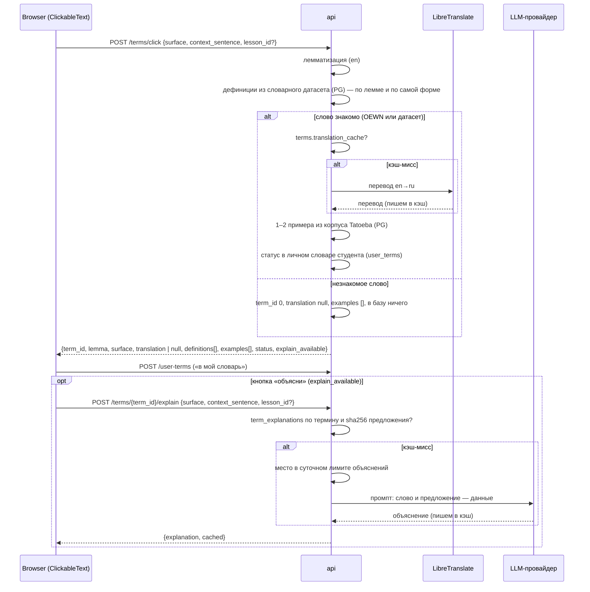

# Поток: клик по слову (везде)

> Работает в любом тексте системы через единый компонент `<ClickableText>`
> (инвариант). Реализуется на этапе 3; примеры Tatoeba подключены в S5-4
> (долг D-1 закрыт), LLM-объяснение — в S5-8 (долг D-2 закрыт, ADR-039).

## Последовательность

Контракт — [04-api.md](../04-api.md): `translation` — `null`, если перевода
нет в кэше, а LibreTranslate не настроен или не ответил; `examples` —
до двух примеров Tatoeba с подписью (S5-4), без корпуса — пуст; `status` —
статус слова в личном словаре студента (S3-5), у других ролей и вне
словаря — `null`. Датасет ищется и по лемме, и по самой форме слова:
у building в попапе есть и build, и building (ADR-017). Незнакомое слово
(нет ни в OEWN, ни в датасете) получает `term_id: 0`, `translation: null`,
пустые `examples` и `status: null`: термин не заводится, LibreTranslate
не зовётся (ADR-017), а попап не предлагает «в мой словарь».

## Содержимое попапа

- Перевод (кэш → LibreTranslate; порядок источников —
  [../integrations/translation.md](../integrations/translation.md)).
- Дефиниция из локального словарного датасета (kaikki.org / Wiktionary-дампы
  в PG, импорт S3-4).
- 1–2 примера из Tatoeba (S5-4, [ADR-028](../decisions.md)): короткие
  английские предложения с леммой термина — в любой форме слова — и
  русским переводом, с подписью по CC BY 2.0 FR (авторы и ссылки на
  tatoeba.org в `attribution`). Корпус не импортирован — список пуст,
  блок скрыт. Импорт — [../integrations/tatoeba.md](../integrations/tatoeba.md).
- Кнопка «объясни» → LLM с контекстом предложения (S5-8, ADR-039): по-русски
  значение слова в этом предложении и заметка о грамматике, простым текстом
  через `<ClickableText>`. Кэш — по термину и нормализованному предложению,
  общий: повтор не зовёт LLM и не тратит суточный лимит. Кнопки нет без
  ключа LLM и у гостя события (`explain_available: false`, долг D-27).
- Кнопка «в мой словарь» → `user_terms(status=1)`; клик участника урока
  по знакомому слову дополнительно пишет кандидата
  `lesson_term_candidates(source='click')` — счётчик кликов, клики
  преподавателя урока не в счёт (S3-7, [ADR-033](../decisions.md)).

## Раскраска слов

`<ClickableText>` токенизирует текст, лемматизирует токены и красит слова
по `user_terms.status` (1..5: new..known); незнакомые слова визуально
отличимы во всех текстах — материалах, транскриптах, субтитрах, Tatoeba,
сгенерированных текстах.

Реализация (S3-1, [ADR-026](../decisions.md)): web режет текст на слова
сам, а леммы и статусы получает пачкой `POST /user-terms/lookup` — одной
на все тексты страницы; слова 1–4 подсвечены (чем новее, тем ярче),
«знаю» и слова вне словаря — без фона. Раскраска и «в мой словарь» —
только у студента.

Связано: [../03-data-model.md](../03-data-model.md) ·
план [stage-3](../../plans/stage-3-dictionary-whiteboard.md)
